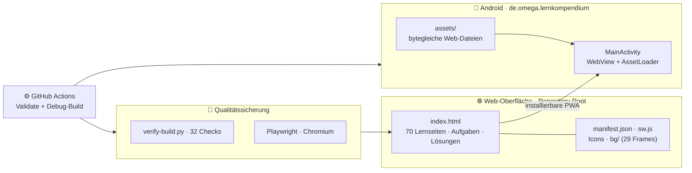

<div align="center">


<a href="https://github.com/Lowgiga/AnFoVO-Lernkompendium">
  
</a>

<br/>


<br/>


</div>

---

## ⚡ Was ist das AnFöVO Lernkompendium?

> Ein digitales, **offlinefähiges Lern-Kompendium** zur Basisqualifizierung nach § 8 AnFöVO NRW. Interaktive Lernseiten, Aufgaben und Lösungen — mit lokal gespeichertem Fortschritt, einer hybriden Buch-/Lernoberfläche und einer Android-WebView-App. **Local-first:** Die Kernanwendung benötigt zur Laufzeit keine externen Dienste.

**Drei Ebenen. Ein Kompendium. Keine Cloud-Pflicht.**

| Ebene | Funktion | Kern | Status |
| --- | --- | --- | --- |
| 🌐 **Web-App** | 70 Lernseiten · Fortschritt · Suche · Druck | `index.html` (eigenständig) | ✅ Verifiziert |
| 🤖 **RobotNav** | Deterministische Buch- und Navigationsassistenz | browserseitig, dekorativ | ✅ Aktiv |
| 📴 **PWA** | Installierbar unter `/AnFoVO-Lernkompendium/` | `manifest.json` + `sw.js` | ✅ Offline getestet |
| 📱 **Android-App** | WebView-Kapsel derselben Web-Dateien | `de.omega.lernkompendium` | ✅ Quellstand v2.9.3 (Release-Signing offen) |

## ✅ Status & Verifikation

| Bereich | Status | Nachweis |
| --- | --- | --- |
| Statische Projektprüfung | ✅ 32/32 Checks grün | `python tests/verify-build.py` |
| Browser- & RobotNav-Harness | ✅ grün (lokal, Chromium/Playwright) | `npm run test:all` |
| PWA/Offline (Subpath) | ✅ lokal getestet (Manifest, Worker, Cache, Offline-Ladevorgang) | `tests/verify-build.py` |
| Android-Build (Quellstand) | ✅ Version `2.9.2`, Version Code `292` | `android/app/build.gradle` |
| GitHub-Actions-CI | ⚠️ Workflow definiert; Läufe hängen von Kontobilling ab | `.github/workflows/android-build.yml`, `BUILD-REPORT-v2.9.1.md` |
| Release-Signing | ⏳ offen (Keystore erforderlich) | `docs/RELEASE_PROCESS.md` |
| Geräteinstallation (Galaxy S25) | ⏳ ausstehend | `PROJECT_MANIFEST.json` |

> **Hinweis zu Versionsständen:** Die Android-Quelle ist auf `2.9.2` (Version Code `292`) gehoben. PWA-/Service-Worker-Cache-Version (`2.9.1`) und einige CI-/Build-Berichtsbezeichnungen (`AnFoeVO-v2.9.1-debug-apks`) stammen noch aus dem vorherigen Release-Zyklus und werden beim nächsten PWA-/Release-Durchlauf mitgezogen. Die Lerninhalte (`index.html`) bleiben unverändert.

## 🧠 Architektur



## 📁 Projektstruktur

| Pfad | Zweck |
| --- | --- |
| `index.html` | Eigenständige Web-Anwendung und Einstiegspunkt |
| `manifest.json`, `sw.js`, `icon-192.png`, `icon-512.png`, `icon-512-maskable.png` | Web-App-Manifest, Service Worker und Installationsicons |
| `bg/` | Hintergrund- und Animationsbilder der Web-Anwendung |
| `.nojekyll` | Hält Jekyll bei einer späteren GitHub-Pages-Veröffentlichung aus |
| `scripts/prepare-pages-surface.sh` | Lokale Kopie der Web-Oberfläche nach `dist/pages/`, ohne Veröffentlichung |
| `android/` | Android-WebView-Projekt inklusive Gradle Wrapper und App-Assets |
| `algorithm/` | RobotNav-Quellmaterial und algorithmische Komponenten |
| `tests/` | Statische Prüfungen, Browser-Smoke-Tests und RobotNav-Tests |
| `docs/` | Architektur-, Design- und Inhaltserhaltungsdokumentation |
| `release/` | Erstellte Testartefakte und Android-Quellpakete |

## ✨ Funktionen im Detail

<details open>
<summary><b>🎓 Lernen & Fortschritt</b></summary>
<br>

- **70 strukturierte Lernseiten** mit Aufgaben und Lösungen zur Basisqualifizierung nach § 8 AnFöVO NRW
- Lernfortschritt wird **lokal gespeichert** und lässt sich über die Sicherungsfunktion exportieren
- **Hybride Oberfläche:** digitales 3D-Buch + lesbare, zugängliche Lernansicht
- Suche, Druckfunktion und Backup-Export sind direkt integriert

</details>

<details open>
<summary><b>✨ Visuelle Weiterentwicklung (v2.9.2)</b></summary>
<br>

- **Silikon-Animationen:** Rubber-Bounce (cubic-bezier) für Buttons, Karten, Toasts und Ringe
- **Dark-Mode-Transition:** sanfter 0,4 s-Farbübergang zwischen Hell/Dunkel
- **Haptic Feedback:** Vibration bei Antworten, Abhaken und Konfetti (Android)
- **Parallax-Stage:** Mausposition steuert subtile 3D-Rotation der Lernbegleiter-Stage
- **Präsentationsmodus:** Fullscreen-Slides mit Tastatur-/Swipe-Navigation und Auto-Play
- **Lern-Dashboard:** SVG-Fortschrittsringe pro Modul + Gesamtfortschritt
- **Progressive Loading:** BG-Preload-Fortschrittsleiste mit Smooth-Transitions
- **Loading-Skeletons:** Shimmer-Platzhalter für Ladezustände
- **Dialog-System:** gestyltes `<dialog>` statt nativem `confirm()`
- **Mobile-Maskottchen:** Mini-Roboter auf Smartphones (≤ 760 px) mit LED-Zuständen

</details>

<details>
<summary><b>🤖 RobotNav — deterministische Navigation</b></summary>
<br>

- Browserseitiger, **reproduzierbarer** Layout- und Navigationshelfer
- Der silberne Roboter ist **rein dekorativ** — keine KI, keine Netzwerkverbindungen, keine Agentenaktionen
- Abgesichert durch einen eigenen **RobotNav-Test-Harness** (verschachtelte Scrollbereiche, Cache-Bereinigung, Observer-Stabilität, Teardown)

</details>

<details>
<summary><b>📴 Offline & PWA</b></summary>
<br>

- Installierbar unter `/AnFoVO-Lernkompendium/` — **alle Pfade relativ**, Manifest + Service Worker + Icons
- Service Worker registriert sich nur unter `http(s)`; `file://` und `android_asset` bleiben voll nutzbar
- Lokale Web-Oberfläche erzeugbar mit `bash scripts/prepare-pages-surface.sh` → `dist/pages/`
- **GitHub Pages ist aktiviert:** https://lowgiga.github.io/AnFoVO-Lernkompendium/ (PWA installierbar, Offline-fähig)
- ⚠️ Vor öffentlicher Freigabe: Impressum-Platzhalter `[vor Veröffentlichung ergänzen: Name, Anschrift, Kontakt]` durch echte Angaben nach § 5 DDG ersetzen — Schritte in [docs/GITHUB_PAGES.md](docs/GITHUB_PAGES.md)

</details>

## 🛠️ Tech-Stack

<div align="center">

</div>

| Ebene | Technologie |
| --- | --- |
| **Web** | HTML/CSS/JavaScript — eigenständige Single-File-App (`index.html`) |
| **PWA** | `manifest.json` · `sw.js` · relative Pfade für `/AnFoVO-Lernkompendium/` |
| **Android** | Java 17 · androidx.webkit 1.18.0 · Gradle 8.13 · AGP 8.13.2 |
| **Tests** | Python (`tests/verify-build.py`) · Node.js + Playwright (Chromium) |
| **CI** | GitHub Actions — Projektvalidierung + Android-Debug-Build |

## 🚀 Schnellstart

### Im Browser

```bash
git clone https://github.com/Lowgiga/AnFoVO-Lernkompendium.git
cd AnFoVO-Lernkompendium
# index.html direkt im Browser öffnen — kein Build, kein Server, keine Abhängigkeiten
```

Das Kompendium wird über die Buch- und Seitennavigation bedient. Für die Kernanwendung ist kein lokaler Entwicklungsserver erforderlich; ein Service Worker wird nur unter `http(s)` registriert.

### Als PWA installieren (optional)

Die Seite über HTTP(S) unter `/AnFoVO-Lernkompendium/` ausliefern und das Installationsangebot des Browsers nutzen.

### Lokale Web-Surface (ohne Android-Teile)

```bash
bash scripts/prepare-pages-surface.sh   # → dist/pages/
```

Das Skript schaltet GitHub Pages nicht ein und ändert keine Repository-Einstellungen.

## 🧪 Qualitätssicherung

### Statische Projektprüfung

```powershell
python tests/verify-build.py
```

### Browser- und RobotNav-Prüfungen

```powershell
cd tests
npm ci
npx playwright install chromium
npm run test:all
```

Bei vorhandenem Chrome/Chromium genügt `CHROMIUM_PATH` statt der Playwright-Installation. Die Browserprüfungen decken Desktop- und Mobilansicht, Seitennavigation, Suche, Fortschrittsspeicherung, Backup-Export, Druckfunktion, Hintergrundressourcen und Browserfehler ab. `npm run test:all` prüft zusätzlich die Auslieferung unter `/AnFoVO-Lernkompendium/`: Manifest, Service-Worker-Registrierung, Cache der Hintergrundframes und einen **Offline-Ladevorgang** (über `file://` registriert sich dabei kein Worker).

### Verifizierter Stand (v2.9.2)

- ✅ Statische Projektprüfung: **32/32 Checks bestanden**
- ✅ Browser- und RobotNav-Harness grün; 70 Lernseiten im Smoke-Test erkannt; keine Seiten- oder Konsolenfehler in den geprüften Läufen
- ✅ PWA-Subpath (Manifest, Worker, Icons, Hintergrundframes, Offline-Ladevorgang) lokal grün
- ✅ GitHub-Actions-CI: Läufe grün auf `main` (Workflow `android-build.yml`; Quellstand v2.9.3)
- ⏳ Release-Signing offen (Keystore) — siehe [docs/RELEASE_PROCESS.md](docs/RELEASE_PROCESS.md)
- ✅ Geräteinstallation (Galaxy S25) verifiziert: v2.9.3 installiert, App startet, Fortschritt bleibt erhalten
- ⏳ Offen: visueller Pixelvergleich; Play-Store-Veröffentlichung

Details zum Build-Weg: [BUILD-REPORT-v2.9.1.md](BUILD-REPORT-v2.9.1.md).

## 📱 Android-App

| Merkmal | Wert |
| --- | --- |
| Application ID | `de.omega.lernkompendium` |
| Version | `2.9.3` |
| Version Code | `293` |
| Minimum Android | API 29 |
| Compile-/Target-SDK | 36 |
| Android Gradle Plugin | 8.13.2 |
| Gradle Wrapper | 8.13 |
| JDK-Laufzeit | 17 oder 21 |
| WebView | androidx.webkit 1.18.0 |
| ABIs | arm64-v8a · x86_64 · universal |

> **Hinweis:** In CI-/Build-Berichten sind noch v2.9.1-Artefaktbezeichnungen (z. B. `AnFoeVO-v2.9.1-debug-apks`) sichtbar. Der Quellstand ist `2.9.2` (Version Code `292`); das Artefakt-Label wird beim nächsten Build-Durchlauf aktualisiert.

### Debug-APK erstellen

**Windows (PowerShell):**

```powershell
cd android
.\gradlew.bat --no-daemon clean :app:assembleDebug
```

**Linux/macOS:**

```bash
cd android
./gradlew --no-daemon clean :app:assembleDebug
```

Der eingecheckte Gradle-Wrapper enthält Launcher-JAR, Windows- und POSIX-Startskripte sowie eine SHA-256-Prüfsumme; CI validiert den Wrapper und baut mit JDK 17, Android SDK Platform 36 und Build Tools 36.0.0. Den Wrapper nicht durch eine ungeprüfte globale Gradle-Installation ersetzen.

Die Debug-APK ist mit dem Standard-Debug-Schlüssel signiert und nur für Tests gedacht. Für eine produktive Veröffentlichung ist ein eigener, sicher verwahrter Release-Keystore erforderlich.

## 📸 Screenshots (geplant)

Aktuell liegen keine Screenshots im Repository. Für die GitHub-Showcase-Ansicht können folgende Aufnahmen ergänzt werden (Pfade als Vorschlag):

- `docs/screenshots/book-view.png` — 3D-Buchansicht mit Lernbegleiter
- `docs/screenshots/reading-view.png` — lesbare Lernansicht
- `docs/screenshots/dashboard.png` — Fortschritts-Dashboard mit SVG-Ringen
- `docs/screenshots/android.png` — Android-App (WebView)

Hinweis: Screenshots dürfen keine personenbezogenen Lernfortschritte, Workbook-Fotos oder verbatim Workbook-Text enthalten (siehe [docs/CONTENT_PRESERVATION.md](docs/CONTENT_PRESERVATION.md)).

## 📊 Statistiken & Aktivität

<div align="center">


<br/>


<br/>


</div>

## 🐍 Contribution-Snake

<div align="center">

<picture>
  <source media="(prefers-color-scheme: dark)" srcset="https://raw.githubusercontent.com/Lowgiga/Lowgiga/output/github-snake-dark.svg" />
  <source media="(prefers-color-scheme: light)" srcset="https://raw.githubusercontent.com/Lowgiga/Lowgiga/output/github-snake.svg" />
  
</picture>

</div>

*Wird per GitHub Action im Profil-Repository [`Lowgiga/Lowgiga`](https://github.com/Lowgiga/Lowgiga) generiert (täglich + manuell auslösbar).*

## 🤝 Contributing

Beiträge sind willkommen — bitte die folgenden Grundsätze beachten:

- **Inhalte bewahren:** Alle 70 Lernseiten und ihre Funktionalität bleiben erhalten; inhaltliche Änderungen erfolgen nie stillschweigend und erfordern einen separaten Review (siehe [docs/CONTENT_PRESERVATION.md](docs/CONTENT_PRESERVATION.md)).
- **Keine stillen Content-Edits:** Änderungen an Lerninhalten nur mit Content-Diff-Report.
- **Offline zuerst:** keine externen Laufzeitabhängigkeiten oder Netzwerkaufrufe für die Kernanwendung; `index.html` bleibt eigenständig.
- **Vor einem Pull Request:** `python tests/verify-build.py` (0 Fehler) und, wenn möglich, `npm run test:all` in `tests/`.
- **Android:** Gradle-Wrapper nicht ersetzen; JDK 17/21 verwenden.
- **Issues/PRs:** Fehler und Vorschläge über GitHub Issues; PRs mit klarer Beschreibung und Testnachweis.

## 🆘 Support

- **Fehler melden:** [GitHub Issues](https://github.com/Lowgiga/AnFoVO-Lernkompendium/issues)
- **Fragen zur Nutzung:** über Issues oder die Projektdokumentation unter `docs/`
- **Sicherheitsrelevante Hinweise:** bitte nicht öffentlich posten; stattdessen ein Issue mit Label `security` (oder direkter Kontakt über das Profil) — Keystore/Secrets niemals committen.

## ⚖️ Lizenz & Grundsätze

- **Apache License 2.0** — siehe [LICENSE](LICENSE). Öffentliche Sichtbarkeit allein begründet keine Weiternutzungsrechte über die Lizenz hinaus.
- **Inhalte bewahren:** Alle 70 Lernseiten und ihre Funktionalität bleiben erhalten; inhaltliche Änderungen erfolgen nie stillschweigend.
- **Offline zuerst:** keine externen Laufzeitabhängigkeiten oder Netzwerkaufrufe für die Kernanwendung.

## 📮 Projektinformationen

- Repository: [Lowgiga/AnFoVO-Lernkompendium](https://github.com/Lowgiga/AnFoVO-Lernkompendium) · Stand: `main` · Quellstand **v2.9.3**
- Änderungsübersicht: [CHANGELOG.md](CHANGELOG.md)
- Produktspezifikation: [PRODUKT_SPEZIFIKATION.md](PRODUKT_SPEZIFIKATION.md)
- Build-Nachweis: [BUILD-REPORT-v2.9.1.md](BUILD-REPORT-v2.9.1.md)
- Technischer Audit: [docs/TECHNICAL_AUDIT.md](docs/TECHNICAL_AUDIT.md)
- Architektur: [docs/ARCHITECTURE.md](docs/ARCHITECTURE.md) · Design: [docs/DESIGN_SYSTEM.md](docs/DESIGN_SYSTEM.md) · Inhaltserhaltung: [docs/CONTENT_PRESERVATION.md](docs/CONTENT_PRESERVATION.md)
- GitHub Pages: [docs/GITHUB_PAGES.md](docs/GITHUB_PAGES.md) · Release-Prozess: [docs/RELEASE_PROCESS.md](docs/RELEASE_PROCESS.md)
- Android-Doku: [android/README-ANDROID.md](android/README-ANDROID.md)

---

<div align="center">


*Offline lernen, Fortschritt behalten — **AnFöVO Lernkompendium** · gebaut von **Lowgiga***

</div>